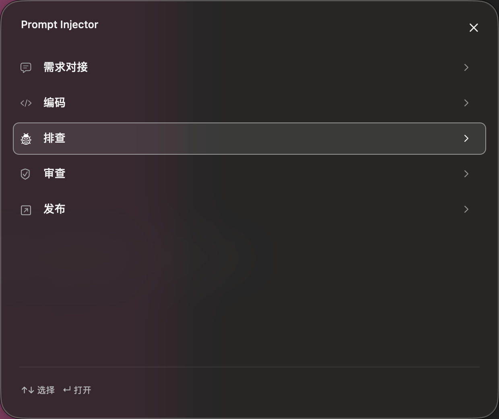
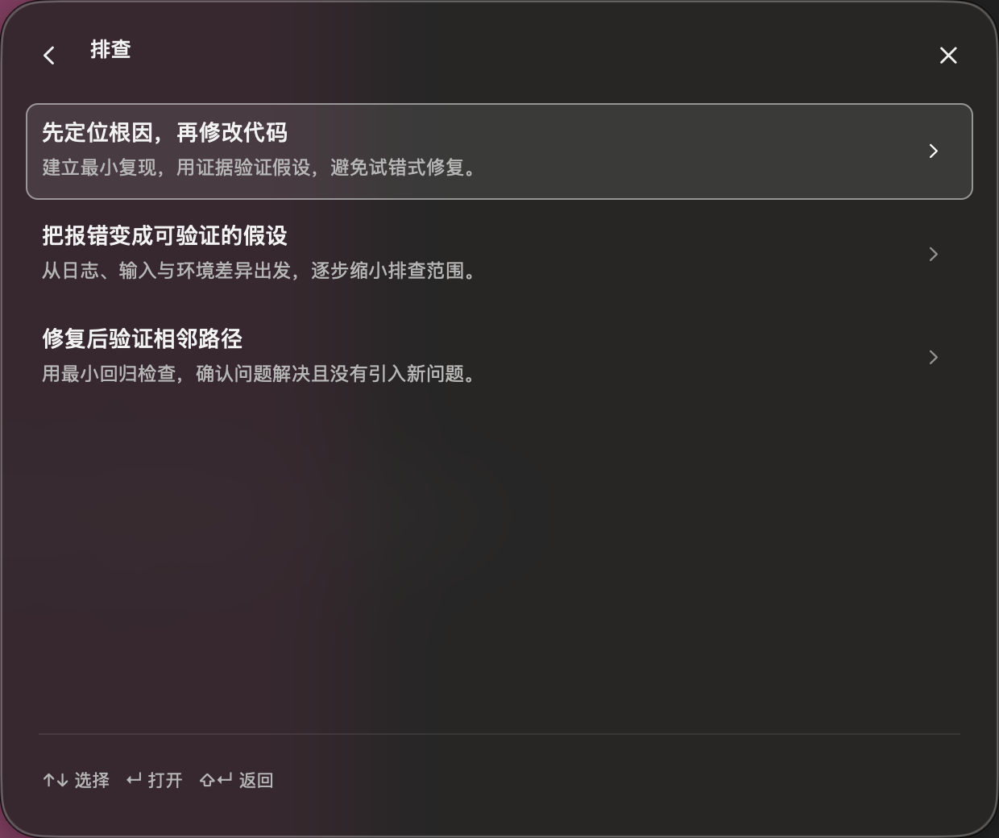
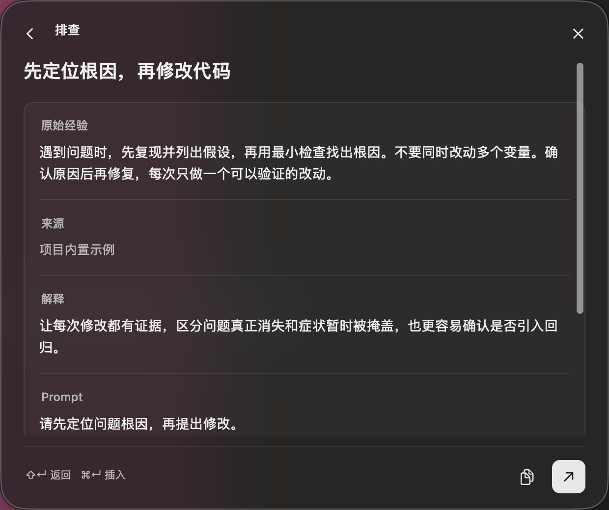

# 界面演进与当前基线

## V7 完整原生移植授权 · v0.6.0 · 2026-11-04 · 最新

用户已明确授权将修复后的 V7 新版 UI 直接移植到 App，并为本轮开发补自运行测试。卡片内容库、保留筛选与滚动的阅读和原位编辑、原文或手动录入、单／多条统一生成确认工作台已实现。复用 AppKit、SQLite、DeepSeek、草稿和统计；先前“仅对应修复、未授权全 V7”的限制已被本次授权替代。125 Swift／10 Python／199原生检查及43图通过；实际验证、独立审核与安装恢复边界见 [V7 原生移植](management-v7-implementation.md)。

独立完整原生复核为 ship。已安装并实际打开同一通过包，构建20261104T041900Z，原3条经验草稿在工作台恢复；两库规范化逐字段比对不变。新增摘要卡片规范按既有设计系统做局部扩展，未把历史V5漂移顺手重写。

## V7 管理修复授权 · v0.5.1 · 2026-11-04 · 历史

用户明确授权先修复现有 V7 Figma 分类、菜单、确认、选择／审核和保存状态，再处理对应实际 AppKit 问题，无须重复批准。授权限本轮十项修复，保留原生现有布局；不自动扩展为全部 V7 卡片网格／原位编辑移植。详细修改、画面ID、测试及回滚见 [管理 UI 修复](management-ui-fixes.md)。

V7 原页面 `386:1661` 原地修正；完整修复前备份页 `408:1124`。分类字段使用锚定 Popover，同一菜单新增；删除紧凑中性、默认取消；搜索＋分类交集、保存剩余19／4／0、字段错误和比较界面均已补齐。真实网页操作只验证预设原型，不表示实际API或SQLite。

对应 AppKit v0.5.1 已实现并安装：分类旧结果防护、轻量分类选择／新增、详情More、就地验证、候选比较、批量生成与人工确认分离、部分保存及稳定审核导航。完整119 Swift／9 Python／165原生／36图通过；独立原生复核发现的空Prompt换条问题修复后仅该项判resolved。正式两库原样保留，真实API／跨应用插入本轮未复验。

## 内容管理 V7 · 2026-11-04 · 初版原型历史

用户明确要求在 Figma 网页版制作可编辑画布与交互原型，沿用现有视觉体系，参考 Ponytail 的黑色底板、细边框与柔光分类点，结合 Square 紧凑卡片及 Linear 连续工作台。授权范围仅限 V7 原型；**未授权将 V7 移植到 App 或替换已安装 v0.5.0**。下方 V6 的实现授权继续有效，不扩展到 V7。

用户已确认三项规则：识别后先勾选再明确生成所选；已确认条目修改标题／分类／Prompt 后恢复待确认；重新生成的新旧结果并排比较，明确采用才替换。内容库默认卡片网格，进入阅读／原位编辑保留筛选上下文；单／多条在同一工作台生成和审核。以上是本版设计约定，本轮以预设状态演示。具体布局、入口与证据见 [V7 工作台记录](content-management-v7.md)。

V7 沿用文件 `2HmvWbRy3wnjiMOwrbh6A6`，页面 `386:1661`；[打开内容库画布](https://www.figma.com/design/2HmvWbRy3wnjiMOwrbh6A6?node-id=386-1662)、[整理工作台](https://www.figma.com/design/2HmvWbRy3wnjiMOwrbh6A6?node-id=387-594)。五个 section（`399:1105`–`399:1109`）组织 50 个根画面，结构回读为 2,766 个文本节点、1,019 个组件实例、零图片填充、748 个有效导航动作，见 `artifacts/management-v7/structure.json`。主工作台二十个复选框绑定不同布尔变量，`actions.json` 保留勾选动作与两处生成门槛条件。已在新网页标签打开 Design 画布，保留交互原型。默认／最小尺寸分别为 1440 × 960、1100 × 720。

首次独立 finish review 为 `fix`，要求补齐比较上下文、失败保留输入、单条按钮文案和真实复选框事件，均已修正并重新导出；最终裁决为 `resolved / ship`，仅覆盖这四项修正，不构成全原型或客户端验收。另补齐五条示例末条的“确认此条”及其确认后画面，采用后的 Prompt 同步为比较中展示的新建议。真实网页已验证零勾选门槛、第一／第五条的独立勾选与计数、勾选不改变当前阅读、生成中至预设已生成仍保留勾选、工作台背景上的新旧比较，以及点击采用后进入待确认。修正后静态导出、`live-compare.png` 与 `canvas-web.png` 位于 `artifacts/management-v7/`，完整范围见 brief。

可编辑画布指文字、组件与向量可编辑；原型表单不接受任意键盘输入。只有勾选与计数使用真实变量，文本、API、生成、编辑、确认、保存等仍是预设 fixture，不表示全部 50 状态均为动态应用逻辑，也不代表任意勾选组合可真实生成或保存。客户端、已安装 v0.5.0、正式两库、Keychain、PRODUCT.md、[DESIGN.md](../DESIGN.md) 与 `.impeccable/design.json` 保持原样；未调用真实 API、执行真实复制／插入或重跑客户端测试套件。此轮原型验证不沿用 V6 客户端的历史通过。

## V6 原生移植授权 · 2026-11-04

用户明确要求将已确认 V6 移植到 App、把条目删除文字改为垃圾桶图标、安装打开最新版，并补自运行验证。该授权替代下方原型阶段的“待批准”状态。实现取消聊天，保留原文／链接整理、独立勾选、原文／可编辑 Prompt、手贴／明确生成、逐条审核与批量事务保存；旧草稿和历史保留。已安装并打开 v0.5.0，最终完整套件通过111 Swift／9 Python／157原生检查／33图；真实 API／跨应用插入不在本轮验收范围。具体结果及恢复入口见 [V6 实施记录](content-management-v6.md#原生实现-v050--2026-11-04)。

## 内容管理 V6 · 原文与 Prompt 分离 · 2026-11-03 · 历史原型

用户最新要求作者原文与可编辑 Prompt 分开：Prompt 可以由 DeepSeek 生成，也可以直接粘贴或手动修改，AI 生成是可选操作。界面保持简洁，取消多轮聊天的决定继续有效。当前设计基线见 [V6 最新细化](content-management-v6.md#最新细化原文与-prompt-分离)；下方一键整理初稿与 V5 记录保留为历史。

[整理经验](https://www.figma.com/design/2HmvWbRy3wnjiMOwrbh6A6?node-id=344-13859)保留左侧二十条经验与独立勾选，右侧上方只读作者原文，下方为带清晰边线的 Prompt 编辑区；`DeepSeek 生成` 作为区块标题旁的小按钮。切换经验保留各条 Prompt；重新生成已有内容先确认替换。已勾选条目的 Prompt 均填写后才能进入既有审核，原文与来源继续保留。未来客户端不得因用户粘贴 Prompt 或进入审核而自动调用 LLM。

既有「手动填写」入口转到[原文／Prompt 并排录入](https://www.figma.com/design/2HmvWbRy3wnjiMOwrbh6A6?node-id=356-4075)，来源可选，直接填写 Prompt 即可继续，在既有审核页补充其他字段。默认 1440 × 960、最小 1100 × 720；生成后、直接粘贴、最小窗口与替换确认的对应画面和八张证据见 brief。页面现有 40 个根画面及 2 个本地组件，无整屏图片填充，沿用现有字体表达、深色 token 和十五色循环。

原文／Prompt 细化的独立视觉复核为 `ship`，范围只含 `artifacts/prompt-pair/` 的八张指定导出，不等于交互或客户端验收。当前／手动两页的变量与连线只演示预设输入；点击 Prompt 区模拟已知粘贴，不能真实键盘录入。其余五张状态／尺寸板为静态展示，替换确认用于预设流程。保存的 Figma 动作 JSON 已通过本地模型模拟，覆盖二十条独立保留、生成／替换、勾选门槛及手动粘贴跳过生成，记录在 `artifacts/prompt-pair/simulation.json`。该次浏览器工具返回 `browser.user is unavailable`，当时未能在真实浏览器点通；后续动效轮已恢复连接，验证范围如下。前一轮 V6 的网页版通过与客户端测试不延用于此次细化。

用户随后要求交互动效，并进一步明确右侧内容卡片应与左侧保持同色。已将 V6 默认、最小和静态画面中的 27 张「条目详情」「作者原文与可编辑 Prompt」「可编辑字段」卡片统一为现有 `shell`（`#101010`）；输入框、边线及 147 条过渡保留，全局 `panel` token 与弹层的 `#151515` 不变。此项仅改 Figma，27 张卡片的不透明实色回读通过，记录见 `artifacts/management-motion/unified-color.json`。新一轮独立复核为 `ship`，只覆盖这 27 张卡片的颜色与三张默认／最小／整理经验静态图的可读性，不重审动效或原生端。先前右侧 `#151515`、左侧和输入框 `#101010` 的解释属于改色前状态。动效仍为 120–180 ms 的淡入淡出，选择、勾选、粘贴和生成的同页变量更新即时执行。配置与回退记录见 [动效细化](content-management-v6.md#交互过渡与卡片层次后续细化)。

改色前的动效轮在真实 Figma 网页点通审核返回整理、空 Prompt 阻止审核、第 8 条预设粘贴、第 9 条预设生成、切回第 8 条保留内容、重新生成后选择保留、进入审核、作者原文分页及说明页返回 Prompt，最终停在审核 Prompt 页并保留第 8 条手贴内容。147 项过渡回读通过，报告为 `artifacts/management-motion/verification-final.json`。该次独立动效复核为 `ship`，仅覆盖改色前的原型配置与 `review.png`、`original-transition.png` 两张端点截图，不作为最新颜色的证据。未测帧率、实际过渡延迟、连续中断或系统 Reduce Motion 行为；未来原生移植应复用既有 Reduce Motion 支持，不新增设置。

**此细化轮当时只交付 Figma 原型，尚未获替换 App UI 的实现批准；后续授权以上方 V6 原生移植记录为准。** 当轮未改客户端源码、正式两库或 Keychain，未安装新包、调用真实 DeepSeek 或重跑 `python3 scripts/test-suite.py`。当时安装包为 V5；`PRODUCT.md`、[DESIGN.md](../DESIGN.md) 与 `.impeccable/design.json` 当时继续记录已实现版本。该轮结构与验证边界见 `artifacts/prompt-pair/report.json`。

## 内容管理 V6 · 一键整理初稿 · 2026-11-03 · 历史设计与验证

初稿阶段用户明确取消 AI 多轮聊天，确认保留「原文／链接 → 一键整理 → 多条独立选择 → 可编辑审核 → 保存」，并要求先展示 Figma 原型，再决定替换 App UI。V5 聊天方向已撤回，不再作为下一版设计基线；下方 V5 的实现授权、已安装行为与历史验收继续作为事实保留。取消聊天不撤销十五色循环、来源 Logo、作者原文、编辑审核、批量保存和删除确认的既有要求。

初稿记录见 [内容管理 V6 · 一键整理](content-management-v6.md)。该轮属于现有深色中性视觉体系内的流程与排版调整，未批准替换视觉 token 或系统字体。新增单列表单与多条选择页仅预览原句的设计已由上节细化；审核集中展示可编辑字段，作者原文与来源只读。管理页保留短标题／使用时机列表、Prompt／作者原文／整理说明分段、分类独立滚动及删除确认。

V6 初稿位于原 Figma 文件 `2HmvWbRy3wnjiMOwrbh6A6` 的页面 `344:12567`，当时共有 33 个根画面，包含新增分类弹层；[管理](https://www.figma.com/design/2HmvWbRy3wnjiMOwrbh6A6?node-id=344-12629)、[新增](https://www.figma.com/design/2HmvWbRy3wnjiMOwrbh6A6?node-id=344-13441)、[多条选择](https://www.figma.com/design/2HmvWbRy3wnjiMOwrbh6A6?node-id=344-13859)、[审核](https://www.figma.com/design/2HmvWbRy3wnjiMOwrbh6A6?node-id=344-14084) 为当时主要入口；多条选择节点现已更新为「整理经验」。默认 1440 × 960，最小 1100 × 720。另保留空输入、链接、处理中、单条、手动填写、保存／删除后、三种阅读页、最小窗口及十五色板。该轮九张本地证据在 `artifacts/management-v6/`，具体文件与状态见 brief。

该轮画布由可编辑文字、组件与向量组成，无整屏 UI 位图；这不代表原型表单接受真实输入。原型只走预设示例；勾选计数和当前原句切换使用 Figma 变量，API、审核保存及删除均为演示，不读写 SQLite。分类弹层受 Figma API 限制居中，移植时须复用原生锚定控件。来源链接会打开真实公开页面。该轮独立视觉复核结论为 `ship`，含义是可交用户审阅，范围限于当时 V6 的指定设计与截图，不等于客户端、真实 API 或系统行为通过。

初稿阶段尚未获用户批准移植到 App。当前安装的 v0.4.0 仍为 V5 聊天界面；该轮客户端补丁仅修复经验识别过度拆分，未移植 V6、未安装新包、未改正式两库或 Keychain。用户确认的是取消聊天与一键整理的产品方向，不等于批准最终视觉稿。该轮代码验证与未覆盖范围见 brief，不沿用下方历史结果充作新版细化的实测。

## 经验理解与整理 V5 · 2026-11-03 · 已接入开发版

用户已明确确认 V5 双栏 UI 可以移植到 App，并要求移植前先说明数据与 LLM 流程；随后明确授权链接读取、单／多条识别、按经验保留独立会话和未发送输入、文字发起讨论与复选框独立勾选、每轮分隔线、可编辑候选及批量事务保存、删除确认且保留历史、三平台来源 Logo 和十五色循环。以上授权已落实到当前开发版，不再重复索要同一批准。

AppKit 已接入左聊天／右经验的等宽双栏与最小窗口、当前经验原文入口、候选逐条审核和保存数量。客户端直连 DeepSeek Fetch／识别／讨论／整理；正式内容与会话活动保留双库边界，删除正式条目保留使用历史及会话归档。实现、脚本、数据库与回滚约定见 [experience-dialogue.md](experience-dialogue.md)，不把原型点击成功当作真实数据行为。

V5 阶段用户曾要求主内容改回左右各半的聊天／识别经验双栏；点经验文字自动发送该条讨论，方框独立勾选；每轮对话增加分隔线；合并 X 与作者原文入口，只显示当前经验的作者原句；保留原五色并扩成十五色，第 16 类回到第 1 色。V5 已按这些反馈完成可编辑、可点击的 Figma 方案，V3／V4 保留历史；V4 常态居中会话与抽屉布局不再作为视觉依据。下一版取消聊天的最新决定以上方 V6 记录为准。

V5 位于原 Figma 文件 `2HmvWbRy3wnjiMOwrbh6A6` 的页面 `323:9335`，多条主画面 `323:9411`、单条 `323:9893`、最小窗口 `323:9652`、作者原文 `323:10001`、十五色板 `323:12388`。20 条经验文字均有变量交互及独立复选框；已点通讨论第 9 条时勾选／取消第 8／9 条而讨论不变、数量更新、当前第 9 条原句及关闭返回、预设追问的两条分隔线，以及第 8／9 条进入 1／2 审核的预设路径。结构校验通过默认与最小窗口的等宽双栏、41 组独立点击区、15 个唯一色及 16→1 引用；共 872 个文本节点、485 个组件实例，无整屏 UI 位图。方案、结构记录与六张证据见 [experience-dialogue-prototype.md](experience-dialogue-prototype.md)。

V5 Figma 原型的独立复核裁决为 `ship`，范围仅限上述设计与点击证据。它不等于真实 LLM、真实保存或客户端验收。回复均为预设；追问和审核／保存只演示第 8／9 条，不代表任意勾选组合可真实生成或批量保存。切换经验会重置原型追问；客户端已按稳定经验 ID 保留各条讨论和输入。

V5 原型阶段结束时尚未授权移植；之后用户已明确同意接入，以上方最新授权为准。App 和 SQLite 在该原型阶段均未改，原型阶段未测试客户端或真实 API、未运行 `python3 scripts/test-suite.py`，这些是历史边界。当前 [DESIGN.md](../DESIGN.md) 与 `.impeccable/design.json` 已按实际 AppKit 更新十五色 token、会话排版、独立点击区和审核字段，系统字体保留。

原生画面对照为 `artifacts/tests/20261102T161703.310103Z/ui/` 中的 `experience-chat.png`、`experience-minimum.png`、`experience-review.png`、`experience-original.png`，其中是两条经验 fixture。与 V5 Figma 默认／最小窗口对照时区分字体和样本量，不能声称图中展示了任意二十条真实识别。实现的独立复核首次返回 `fix`，首聊覆盖未发送输入、五百条消息越界导致草稿无法保存、X 多行正文裁切三项已修复并保留回归；修复后裁决为 `resolved / ship`，仅覆盖这三项修复，未进行全量重新审查。具体修复与测试入口见 [bugs.md](bugs.md) 和 [testing.md](testing.md)。

最终完整套件 `artifacts/tests/20261102T162434.250338Z/summary.json` 通过 102 项 Swift、9 项 Python、147 项原生检查，留存 29 张有效截图；构建 `20261102T162441Z`，源码指纹 `d304150aced6f34ef18b938bcafcd57b7e74a97931ecc6cbb9554ab1f36d0da9`。同构建真实 API 隔离库报告 `artifacts/experience-verification/20261102T162434.202069Z/report.json`：读取 X 原文、识别二十条、选择两条、真实多轮讨论、整理、修改候选、保存和重开通过，`fetchVerified=true`、`realMultiRound=true`、`formalLibraryChanged=false`、`realCodexInsertion=false`。详细证据以 [testing.md](testing.md) 为准。已将同一验证包更新到常用启动位置，实际打开新版双栏；版本、签名与逐文件摘要一致，旧28条／7分类／5次使用事件／0旧草稿逐字段不变，安装记录见 artifacts/installation/v040/report.json；真实 Codex 跨应用插入、物理断网和系统拒绝场景未在本轮复测。

## 经验理解与整理 V4 · 2026-11-02 · 历史方案

用户要求先在 Figma 网页版设计：删除入口／确认、多轮理解概念后自动填入可编辑字段、X／GitHub／Reddit 来源标识；并追加直接发链接、单条和多条经验分别处理。用户随后否决 V3 聊天布局，要求参考 Claude Code／Codex。V4 将连续对话作为主区域，底部固定输入，来源与多经验选择按需展开；原 V2 与 V3 保留，V3 聊天不作为视觉批准依据。

范围仅为可编辑、可点击的 Figma 原型，尚未授权替换 App。预设公开示例演示单条／20 条来源、当前经验切换、逐条审核、原文与讨论补充分开、保存数量和删除确认；不声称已抓取网页或调用真实模型。方案与边界见 [experience-dialogue-prototype.md](experience-dialogue-prototype.md)。

该轮稿位于原 Figma 文件 `2HmvWbRy3wnjiMOwrbh6A6` 的 V4 页面 `272:4664`，主会话为 `272:4899`。本轮检查保留 1,258 个文本节点与 811 个组件实例，无整屏 UI 位图；字体为 Noto Sans SC／Inter。六张 Figma 网页版原生 1× 最终导出及状态对照见 brief 的 V4 历史记录。

独立视觉复核先返回 `fix`；数量入口截断修正后，后续裁决将该项标为 `resolved` 并返回 `ship`。该结论限于指定六张截图的视觉范围，不等于全功能、真实 LLM 或原生客户端验收。原型的多条路径预设勾选第 8／9 条并分别审核，不支持任意输入；本轮未调用 LLM、未实际抓取网页、未保存或删除本地内容。

V4 当时未获 App 移植授权；上述视觉复核不构成实现批准，现布局已由 V5 替代。该轮客户端、正式资料库、现行 [DESIGN.md](../DESIGN.md) 与 `.impeccable/design.json` 均保持原样。正式实现仍须明确删除的数据策略并补齐相关测试；该轮没有客户端代码变更，未重跑客户端测试套件。

## 内容管理 V2 · 2026-11-01 · 已授权移植

用户试用 v0.3 后指出标题、简述、Prompt 和解释编排过密，要求使用 Impeccable 和 Figma 网页版先调整内容管理；以当前 App 为基准，原内容管理草稿 V1 仅复用资源。明确要求标题／副标题用于快速扫读，作者原文按需点击查看，新增分类按现有五色顺序循环。此次颜色决定替代旧版新增分类统一中性色的方案。

已在原 Figma 文件新建「内容管理 · 阅读重排 v2」：Prompt、作者原文、整理说明三状态及最小窗口；保留 V1。示例标题和简述已精简，原文和来源分层阅读，分类第六／七项复用黄／蓝。四张设计导出通过独立视觉复核，网页三态切换已实际点击验证；用户随后明确确认“可以移植到 APP”，并追加实时分类上下文、近义分类复用与增长后滚动。授权按本稿更新 AppKit，保持既有内容与来源，不自动合并历史分类；具体实现与验收见下述 brief。具体约定见 [content-reading-v2.md](content-reading-v2.md)。

## 本轮实现授权 · 2026-11-01

用户明确授权下一版 MVP：Mac App 直连 DeepSeek，把粘贴原文与可选来源整理为可编辑候选；取消固定五分类限制，支持新增与选择。模型最终确认为 DeepSeek V4.1 Flash 1017（deepseek-flash），保留 high 思考。此次决定替代旧 Stage 3 Go + chi 中转和固定分类计划。复用现有深色原生管理、编辑、草稿、浮窗、插入与计次；只增加整理/取消、Keychain 配置、候选审核和新分类名称的必要控件。不新增网页抓取、账号、同步、模型列表或其他配置开关。候选需明确采用，原文与来源不被覆盖。本轮自动化和真实系统验收分别记录在 llm.md / testing.md，不延用历史成功冒充本轮实测。

## 源码合并授权 · 2026-10-31

用户明确要求把本轮改动、验证和边界写入 commit，并直接推送或合并到 main。授权覆盖当前 Figma 原生移植与已提交修正，以及与 main 的兼容合并；不新增 PR、标签或安装包发布。合并时保留 main 的 Codex 焦点／空框占位修复与回归，沿用当前管理 UI，并在完整套件通过后推送。

合并包已完成 73 Swift、7 Python、111 原生检查与 19 张截图；独立签名包构建 `20261031T011333Z`，指纹 `20baaf6093e9d54128c44a1dfa7e9f3e7c2ce543c1fa3a8185f7c0b9a38941e4`。旧表单测试已迁移到当前编辑器，两边数据库／焦点／空框回归保留。未重新人工验证合并包的真实跨应用插入，不借用历史人工样本作为当前包验收。

## 对齐与图标复核 · 2026-10-31 · 已完成

用户指出浮窗数量／箭头、搜索文字／图标、返回箭头／分类名的视觉中线问题，要求先全量查找汇总，再统一修复，并将新增操作改为纯加号。已汇总浮窗行与页头、管理搜索与侧栏、编辑输入与状态、统计图例／分布／排行六组。源码已统一按字形和原生基线度量摆放；输入框使用稳定基线，条目紧凑模式按窗口宽度判断。

用户进一步指出 Dock Logo 外有白色正方形。已确认源图外围白色画布不透明，授权去除外围背景，保留黑色圆角底板与原有品牌标志；PNG、运行时图标与打包 ICNS 使用同一透明源图。

用户解锁后完成本轮完整套件：52 Swift、7 Python、108 原生检查及 19 张有效截图通过，报告 `artifacts/tests/20261030T162746.795484Z/summary.json`，构建 `20261030T162750Z`，源码指纹 `ffbe2067cbe2fae4e26a2103420947320e65bf8bba802c0090d440294c140bba`。源图、10 份构建表示与打包 ICNS 的外围透明采样通过，原生检查同时验证 PNG、运行时应用图标及 ICNS。独立视觉复核为 ship，覆盖当前尺寸矩阵的对齐和图标资源／打包。实现和回归入口见 bugs.md 的 PI-013／PI-014。

已通过 CUA 正常退出旧版本，日志确认草稿与队列排空；当前构建重新启动，打开内容管理页，原有 8 条用户内容保留。Dock 的独立 CUA 目标超时，未取得实际 Dock 画面，不把透明度检查写成 Dock 目测通过。本轮未重复真实跨应用插入。

## 当前实现授权 · 2026-10-30

用户已明确要求将当前 Figma 管理页、浮窗、Logo 与菜单栏图标移植到原生代码并打开供点击，授权本轮客户端实现。范围包含管理页的手动新增、编辑、标题／简述搜索和本地使用统计；沿用本地 SQLite、只填写不发送及既有系统插入保护，不引入云端、账号或 LLM。以本轮实际构建与运行结果更新完成状态，不再重复索要相同实现批准。

用户试用后明确追加：管理窗口需有原生 macOS 红黄绿按钮，支持关闭、最小化和放大。此反馈优先于 Figma 无标题栏的外壳形式；内容布局保持当前方向，关闭仍须先保存草稿。

用户随后要求预览分类色点与文字对齐，或去点只留名称，并放大分类名称；本轮采用去掉预览色点、14 pt 中等字重且与标题左对齐。另明确要求全界面移除无用说明：重复示例来源、本地存储／浮窗调用旁白、编辑格式与作者提示、统计口径说明等常驻文字不再显示。实际原文、来源与解释字段保留，必要标签、状态、错误和快捷键保留。

用户还要求绿色按钮进入独立桌面空间的原生全屏，并使用自己的 Logo 作为应用图标。管理窗口增加主全屏资格，显示时切换正式应用身份并设置品牌图标；原生全屏进出已检查，真实应用绿色按钮点击亦产生 fullscreen-entered 事件。此授权针对当前 macOS 客户端管理窗口，不新增服务器界面或后端功能。

当前开发版已将最新 Figma 管理页、浮窗与图标接入 Swift/AppKit，功能和数据验证见 [figma-integration.md](figma-integration.md)。新版内容与完整原生 UI 回归已通过；历史 Stage 1 插入验收不自动等于本轮重新测试。早期浅色设计方案已否决，不作为后续开发依据；不需要重新等待旧原型的审批。

当前方向为中性深色面板、白色通用控件、渐变柔光 Logo 与分类语义色。设计规则见 [DESIGN.md](../DESIGN.md)，布局和交互约定见 [launcher-brief.md](launcher-brief.md)。私人参考截图、对话和早期设计文件链接不公开。

## Stage 1 历史页面

| 分类 | 列表 | 详情 |
| --- | --- | --- |
|  |  |  |

这些截图来自 macOS 原生运行检查，只包含项目示例和受控背景。它们不是静态设计稿，也不是对其他应用插入兼容性的证明。

这些为 v0.1 历史截图，新版详情已改为「Prompt / 经验与来源」两段。窗口仍默认 620 × 520 pt、最小 360 × 300 pt，可移动、缩放并记忆位置和尺寸；复制与插入为带辅助功能标签的图标按钮。

## 重要演进

- 单浮窗三级导航；标题与简述保留，长正文可滚动，导航和底部操作固定。
- 清除右上角重复应用名称，统一返回箭头、标题、行内容和详情左侧对齐。
- 使用 NSVisualEffectView 与背景遮罩实现磨砂，不用整个窗口透明度模拟静态材质。
- 增加短促的窗口显示/隐藏及页面前进/返回动画；支持快速中断和减少动态效果。
- 先通过真实 Codex 插入，再加入 SQLite 分层读取；数据层变更保留现有视觉和插入约束。
- 锁屏曾使截图与动画时序检查失败；解锁后同构建通过。测试环境必须记录，不把旧截图当作本轮新结果。

## 验收状态

2026-10-30：用户已授权实现 v0.2.0 的独立管理窗口和手动新增闭环，沿用当前深色原生视觉，不再等待历史原型审批；授权范围不含提交或发布。实现与自动化验证记录见 [stage2-acceptance.md](stage2-acceptance.md)，真实新增内容的系统插入已由用户确认并通过全文回读。该授权不扩展到重做浮窗或后续 Stage 2 小版本。

2026-10-30 后续授权：用户要求把本轮实现、验证与回滚方法写入可供后续 Agent 阅读的提交，并合并/推送至 `main`。该授权覆盖本次 v0.2.0 源码交付；不扩展到新标签、安装包发布、CI 部署或后续版本开发。

Stage 1 已在当前 macOS / Codex 普通主输入框范围完成验收，细节见 [stage1-acceptance.md](stage1-acceptance.md)。其他应用、question 自由回答框、大规模内容与最低系统版本不据此宣称通过。

长内容编辑已接入独立管理窗口；管理窗口与浮窗按下方 Figma 记录移植，保持原生窗口、焦点与键盘行为。原 [Stage 2 小版本计划](stage2-plan.md) 已注明本轮用户明确扩大后的范围，开发版不提前标记为稳定验收。

## 内容管理视觉参考 · 2026-10-30

用户明确允许参考 Web 产品风格，并指定 Ponytail 的 [The Band](https://github.com/DietrichGebert/ponytail/blob/main/assets/band/band.png) 和 [Board / dashboard](https://github.com/DietrichGebert/ponytail/blob/main/assets/band/board.png)。两张公开原图均已查看，作为内容管理下一轮设计的主要视觉参考。

- Board：深黑背景、略亮的炭灰面板、低对比细边界、柔和圆角；清楚的侧栏与内容区，白色主文字和灰色辅助文字，少量彩色标记。
- Band：紧凑横向操作条、分组与细分隔线；操作与状态清楚区分。按用户最新截图校正，管理草稿中的选中项和主要操作使用深灰底、白色文字与图标，辅助数量为灰色。
- 将这些视觉语言用于分类、标题与简述列表、独立内容编辑区。原始经验、来源、解释与 Prompt 继续分开保存和呈现，Prompt 保留足够的编辑空间。
- 用户随后明确追加 Prompt 使用次数统计与排行，纳入 Figma 草稿。统计页借鉴 Board 的指标、趋势与表格组织；Figma 数据为演示。当前开发版已接入真实成功复制／插入事件与本地持久化，不使用演示历史。参考图中的费用与 token 不成为本项目需求。
- 用户先指出分类容易误触，随后明确要求去掉分类外框、选中项改为深灰底和彩色字体、分类色点带柔光。保留 44 高整行点击区和 10 行间距，主导航与分类之间保留分隔线，不采用逐行描边；已接入原生控件并完成画面对照。
- 用户进一步要求 Logo 发亮、所有分类色点都发亮：四个管理画面中的 Logo 增加同形渐变柔光，全部分类色点统一提亮，包括侧栏、预览、编辑选择和统计图例／分布；状态提示圆点继续按状态含义呈现。
- 用户随后纠正通用控制泛用蓝色的问题：全部内容、使用统计、新建／编辑／保存及重试操作、选中页签和统计时段统一采用白色文字与图标；数量与边界回归中性灰。此前彩色文字要求仅保留在分类语义，Logo、发光分类色点和统计系列保留原配色。
- 用户要求内容预览右下角的复制与编辑仅显示图标，两者统一沿用复制按钮样式：透明背景、细灰边框、白色图标，均为 40 × 40；原生实现已提供 tooltip 和辅助功能名称，并完成画面对照。

状态：用户已确认“内容管理可以了”。内容管理静态视觉方向通过，含无框分类、深灰选中态、白色通用操作、分类彩色文字、柔光色点和统一图标按钮。此确认不代表客户端实现或统计采集已获验收。

## 浮窗视觉更新 · 2026-10-30

用户要求在 Figma 依据当前已确认的管理界面语言优化浮窗，授权本轮视觉设计。提案范围见 launcher-refresh-brief.md：保留单窗三级导航、默认与最小尺寸、现有快捷键及只填写不发送的边界；沿用深色中性控件、Logo 与分类柔光，并提议详情以“Prompt / 经验与来源”分段查看，另一段仍将原始经验、来源、解释分开呈现。

用户后续要求去掉“目标 Codex”和全部分类色点，分类名称文字直接发亮。此反馈已同步到默认、详情状态与最小尺寸画面：不显示目标应用标签，移除 16 个分类点，在 16 处分类名称与顶部当前分类文字上使用同色柔光，Logo 光效保留。内容管理页继续沿用已确认的独立规范。

状态：Figma 已完成默认三级、详情经验分段、目标失效，以及最小尺寸三级共八个静态画面。此前八状态静态复核结论为 ship；目标文案与分类光效调整已检查三份最终导出。随后用户明确要求整套移植，已接入客户端；分段切换、管理数据与完整原生 UI 检查已通过，已完成实际画面对照；本轮未重复真实跨应用插入。静态复核不替代真实原生验收。
