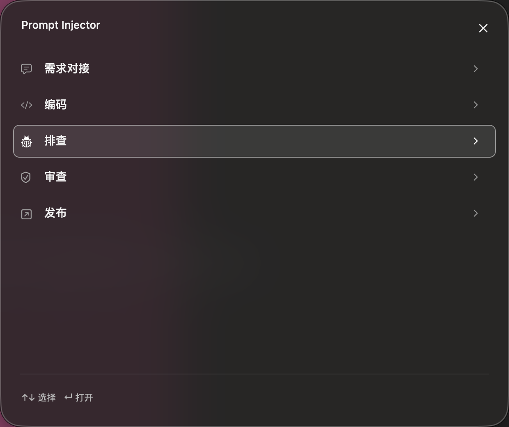
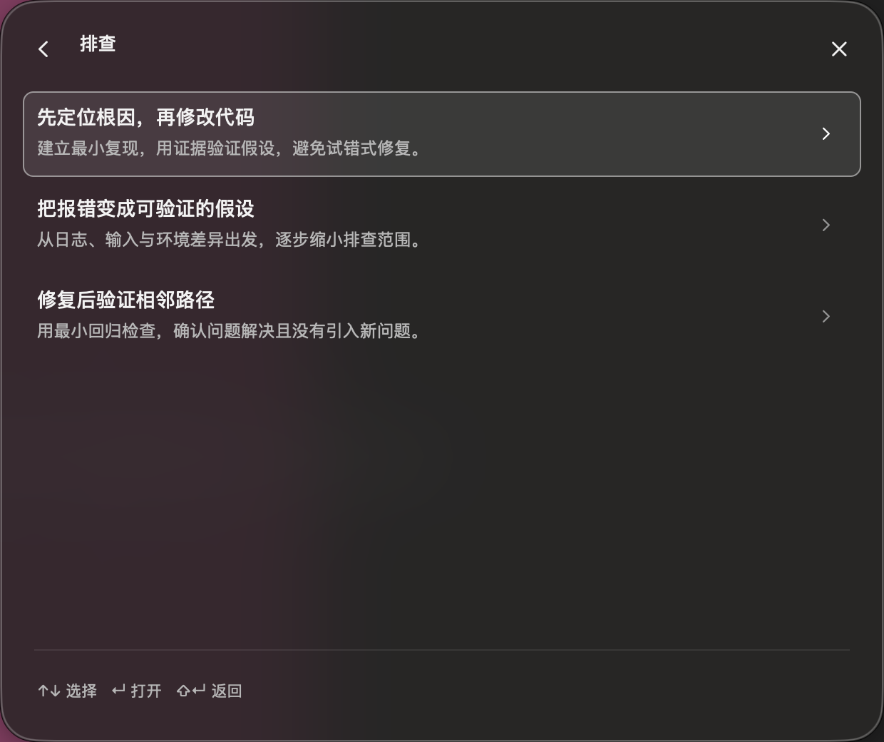
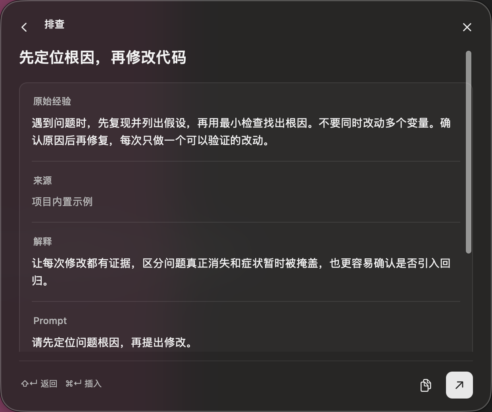

# 界面演进与当前基线

当前基线是已实现的 Swift/AppKit 原生深色浮窗，用户已确认先保留这版 UI。早期浅色设计方案已否决，不作为后续开发依据；不需要重新等待旧原型的审批。

外壳方向是深炭灰磨砂、大圆角、细边框和柔和阴影；内部是紧凑的三级工具界面。设计规则见 [DESIGN.md](../DESIGN.md)，布局和交互约定见 [launcher-brief.md](launcher-brief.md)。私人参考截图、对话和早期设计文件链接不公开。

## 当前页面

| 分类 | 列表 | 详情 |
| --- | --- | --- |
|  |  |  |

这些截图来自 macOS 原生运行检查，只包含项目示例和受控背景。它们不是静态设计稿，也不是对其他应用插入兼容性的证明。

窗口默认 620 × 520 pt、最小 360 × 300 pt，可移动、缩放并记忆位置和尺寸。详情采用一个轻边框容器分段展示原始经验、来源、解释和 Prompt；复制与插入为带辅助功能标签的图标按钮。

## 重要演进

- 单浮窗三级导航；标题与简述保留，长正文可滚动，导航和底部操作固定。
- 清除右上角重复应用名称，统一返回箭头、标题、行内容和详情左侧对齐。
- 使用 NSVisualEffectView 与背景遮罩实现磨砂，不用整个窗口透明度模拟静态材质。
- 增加短促的窗口显示/隐藏及页面前进/返回动画；支持快速中断和减少动态效果。
- 先通过真实 Codex 插入，再加入 SQLite 分层读取；数据层变更保留现有视觉和插入约束。
- 锁屏曾使截图与动画时序检查失败；解锁后同构建通过。测试环境必须记录，不把旧截图当作本轮新结果。

## 验收状态

Stage 1 已在当前 macOS / Codex 普通主输入框范围完成验收，细节见 [stage1-acceptance.md](stage1-acceptance.md)。其他应用、question 自由回答框、大规模内容与最低系统版本不据此宣称通过。

后续长内容编辑放在独立管理窗口。新增管理界面须沿用现有视觉规则，不重新设计已接受的浮窗；功能按 [Stage 2 小版本计划](stage2-plan.md) 增量加入。
